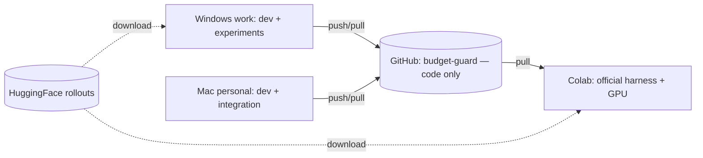

# BAGEN — Week 1 Walkthrough (Windows + Mac + Colab)

> Goal of Week 1: a `(x_t, y_t)` table you trust + a data dictionary, with the env set up on Windows.

---

## 0. Readings (do these first — ~2 short sessions)

| # | Read | Link | Why |
| - | ---- | ---- | --- |
| 1 | **BAGEN paper** — intro + the results table with the 47% coverage number | https://arxiv.org/abs/2606.00198 | The problem you're improving. |
| 2 | **BAGEN homepage** (figures, demo) | https://ragen-ai.github.io/bagen/ | Fast visual intuition. |
| 3 | **A Gentle Introduction to Conformal Prediction** — Angelopoulos & Bates, §1–4 | https://arxiv.org/abs/2107.07511 | The whole method, with Python examples. Read this slowly. |
| 4 | **BAGEN dataset card** | https://huggingface.co/datasets/MLL-Lab/BAGEN | The data you'll extract from. |

Coming up in later weeks:
**CQR** https://arxiv.org/abs/1905.03222 · **ACI** https://arxiv.org/abs/2106.00170 ·
**CopulaCPTS** https://arxiv.org/abs/2212.03281 · **SPCI** (Xu & Xie, ICML 2023 — search the title).

**You "get it" when you can answer (write 1–2 sentences each):**
1. Why is the remaining-budget target `y_t` "online and partly self-induced," and why does using *logged* rollouts make it tractable?
2. Why does plain split-conformal under-cover here? (hint: temporal drift breaks exchangeability)
3. Why must you split calibration/test **by rollout**, never by prefix?

---

## 1. Windows environment (done by setup)

```powershell
# Miniconda (user-scope), then a conda-forge env (avoids Anaconda channel ToS on a work machine)
& "$env:USERPROFILE\miniconda3\Scripts\conda.exe" create -n budget python=3.12 -c conda-forge --override-channels -y
& "$env:USERPROFILE\miniconda3\envs\budget\python.exe" -m ensurepip --upgrade
& "$env:USERPROFILE\miniconda3\envs\budget\python.exe" -m pip install pandas numpy scikit-learn lightgbm scipy matplotlib jupyter pytest huggingface_hub
```

Because the installer used `/AddToPath=0`, call tools by full path or run
`& "$env:USERPROFILE\miniconda3\Scripts\conda.exe" init powershell` once and reopen the terminal.

---

## 2. Mac environment + the Git repo

```bash
curl -L -o ~/miniconda.sh https://repo.anaconda.com/miniconda/Miniconda3-latest-MacOSX-arm64.sh
bash ~/miniconda.sh -b -p ~/miniconda3 && ~/miniconda3/bin/conda init zsh   # reopen terminal
conda create -n budget python=3.12 -c conda-forge --override-channels -y && conda activate budget
pip install -r requirements.txt

git clone https://github.com/<you>/budget-guard.git && cd budget-guard
```

The BAGEN repo is cloned separately (it is **not** part of `budget-guard`).

---

## 3. Get the data

- **Smoke sample (no download):** `BAGEN/_smoke/sokoban_dialogues.json`. Start here.
- **Real rollouts (HuggingFace):**

```bash
python -c "from huggingface_hub import snapshot_download; snapshot_download(repo_id='MLL-Lab/BAGEN', repo_type='dataset', local_dir='data/bagen_hf', allow_patterns=['manifest.jsonl'])"
python -c "from huggingface_hub import snapshot_download; snapshot_download(repo_id='MLL-Lab/BAGEN', repo_type='dataset', local_dir='data/bagen_hf', allow_patterns=['estimation/**'])"
```

Keep `data/` out of Git (see §7).

---

## 4. `budget_guard/extract.py`

A faithful, `ragen`-free port of the prefix → `(x_t, y_t)` logic in
`ragen/env/token_estimation/env.py` (`_flatten_rollouts`, lines ~574–745). It is committed in
this repo. Run it:

```bash
python budget_guard/extract.py                  # uses the bundled _smoke sample (via ../BAGEN)
python budget_guard/extract.py /path/to/dialogues.json
```

**Simplification to flag:** the starter uses raw per-turn totals. For real rollouts where logged
input tokens *include replayed history*, `env.py` first converts request-usage →
per-turn-excluding-history (`_convert_request_usage_to_turn_usage`). The Colab diff (§6) catches
this; if `y_t` mismatches there, port that helper too.

---

## 5. Validate + the data dictionary

Running `extract.py` prints the table and runs invariants (`y == max(0, total − tokens_so_far)`,
`y` non-increasing in `k`). Field definitions live in `budget_guard/data_dictionary.md`.

---

## 6. Colab fidelity check (one-time, no API key needed)

```python
!git clone --recurse-submodules https://github.com/mll-lab-nu/BAGEN
!git clone https://github.com/<you>/budget-guard.git
%cd BAGEN
!pip -q install omegaconf hydra-core pydantic numpy && pip -q install -e ./verl --no-deps
import sys; sys.path.insert(0, "/content/budget-guard")
from ragen.env.token_estimation import TokenEstimationEnv, TokenEstimationEnvConfig
from budget_guard.extract import load_rollouts, flatten_to_samples
p = "_smoke/sokoban_dialogues.json"
env = TokenEstimationEnv(TokenEstimationEnvConfig(input_path=p, max_context_window_tokens=2500))
official = {s.sample_id: s.actual_remaining_total_tokens for s in env.samples}
ours = {s.sample_id: s.y for s in flatten_to_samples(load_rollouts(p), max_ctx=2500)}
mism = {k: (official[k], ours.get(k)) for k in official if official[k] != ours.get(k)}
print("mismatches:", mism or "NONE")
```

Target: **`NONE`** on ≥20 prefixes. Also run the README's `DRY_RUN=1 ... sokoban.sh` once to log a reproduced number.

---

## 7. How work syncs across Windows, Mac, Colab

**Principle: code syncs via Git; data and outputs do not.**



1. **One private repo `budget-guard`** = your only source of truth (`budget_guard/`,
   `requirements.txt`, `notes/`, `docs/`, `.gitignore`). It does **not** hold BAGEN, `verl`, the
   dataset, or outputs. Daily: `git pull` before, `git commit && git push` after.
2. **BAGEN is cloned separately per machine.** Point your code at it with `BAGEN_DIR`
   (defaults to `../BAGEN`), so the same code runs everywhere with no hardcoded paths.
3. **Data + figures never go in Git** (large + regenerable). Download rollouts from HuggingFace
   per machine; regenerate figures by re-running code.
4. **Colab**: `git clone` your repo each session; push back via a token remote
   (`https://<PAT>@github.com/<you>/budget-guard.git`).
5. **One-line flow:** edit on Windows downtime → `push` → at home `pull` on Mac, extend → `push`
   → Colab `pull`s for the one-time official check.

---

## Week 1 — Definition of Done
- [ ] Readings done + the 3 self-check answers written.
- [ ] Windows env works (`python -c "import pandas,sklearn,lightgbm"` → no error).
- [ ] `budget-guard` repo created and cloned on Windows + Mac.
- [ ] `budget_guard/extract.py` runs on `_smoke` (asserts pass).
- [ ] `data_dictionary.md` written.
- [ ] Colab diff = `NONE` on ≥20 prefixes + 1 reproduced BAGEN number logged.
